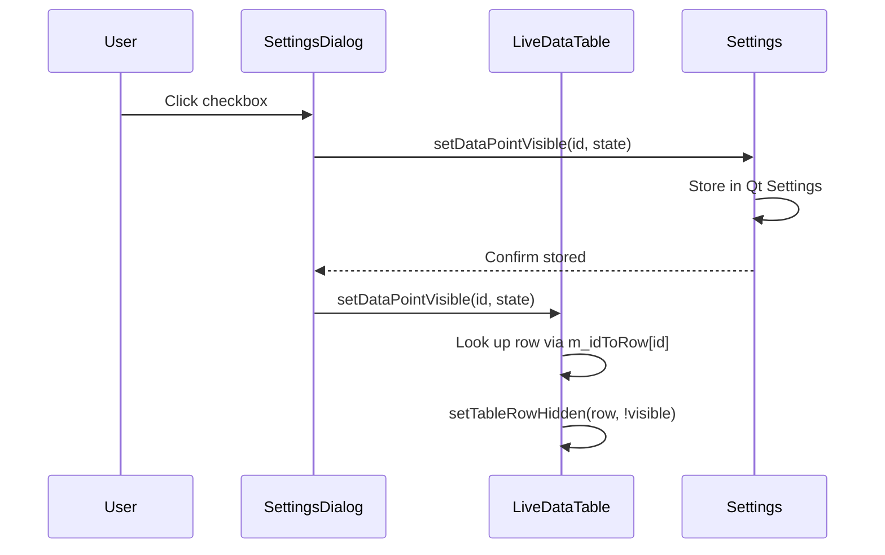

# ESP-NOW Data Integration Guide - Complete System Documentation

## Table of Contents
1. [Overview](#overview)
2. [Data Flow Architecture](#data-flow-architecture)
3. [ ESPNOW Data Format](#esp-now-data-format)
4. [Unified Data Point System](#unified-data-point-system)
5. [ESPNOW vs UART BMS Data Routing](#espnow-vs-uart-bms-data-routing)
6. [Visibility Toggle System](#visibility-toggle-system)
7. [Settings Integration](#settings-integration)
8. [Implementation Details](#implementation-details)
9. [Adding New ESPNOW Data Points](#adding-new-esp-now-data-points)
10. [Troubleshooting](#troubleshooting)

---

## Overview

The MultiDisplay-Unified system integrates ESP-NOW data through the **OpenDashBridge** component, which acts as a bridge between wireless ESPNOW devices (BMS, VESC, etc.) and the unified data store.

### Key Components

```
┌─────────────────┐     ESP-NOW     ┌──────────────────────┐
│  rAtTrax-BMS    │ ──────────────> │    ESP32 Bridge      │
│   (BQ76952)     │                   │   USB CDC-ACM      │
└─────────────────┘                   └────────────────────┘
                                            │
                                            ▼
                                    ┌──────────────────────┐
                                    │  OpenDashBridge      │
                                    │  (OpenDashBridge.cpp)│
                                    └──────────────────────┘
                                            │ frameParsed()
                                            ▼
                                    ┌──────────────────────┐
                                    │ UnifiedDataStore     │
                                    │ (setDataPoint)       │
                                    └──────────────────────┘
                                            │
                        ┌───────────────────┼───────────────────┐
                        ▼                   ▼                   ▼
                ┌───────────────┐  ┌───────────────┐  ┌───────────────┐
                │ LiveDataTable │  │ DashboardWidget│ │ DataPointRegistry│
                │ (Visibility)  │  │   (Plots)     │  │  (Metadata)   │
                └───────────────┘  └───────────────┘  └───────────────┘
```

---

## ESP-NOW Data Format

### Text-Based Format (Primary)

ESPNOW data points are sent as text lines in the format:

```
DP:0xXXXX:YYYY.YY
```

Where:
- `DP:` - Prefix indicating a data point update
- `0xXXXX` - 4-digit hexadecimal DataPointID (16-bit)
- `YYYY.YY` - Floating-point value

**Examples:**
```bash
DP:0x0100:3250.00    # Engine RPM = 3250
DP:0x0400:48.50      # BMS Pack Voltage = 48.5V
DP:0x0410:3.95       # BMS Cell 1 Voltage = 3.95V
DP:0x060C:2450.00    # VESC eRPM = 2450
```

### Binary Format (Fallback)

When text parsing fails, the system attempts binary packet parsing:

```
┌─────────┬───────┬───────┬─────────┬─────────┬─────────┬────────┐
│ SYNC    │ CMD   │ LEN   │ DP_ID   │ VALUE   │ CHECKSUM│
│ 0xAA    │ 0x81  │ 0x06  │ HI:LO   │ FLOAT32 │         │
└─────────┴───────┴───────┴─────────┴─────────┴─────────┴────────┘
```

- **SYNC** (0xAA) - Packet synchronization byte
- **CMD** (0x81) - Data response command
- **LEN** (0x06) - Payload length
- **DP_ID** (hi:lo, big-endian) - Data point ID
- **VALUE** (4 bytes, little-endian float32) - Sensor value

---

## Unified Data Point System

### DataPointID Enum Structure

All data points are defined in `UnifiedDataPoint.h` using a C++ enum class:

```cpp
enum class DataPointID : uint32_t {
    // Engine/ECU (0x0100-0x01FF)
    RPM = 0x0100,
    CoolantTemp = 0x0101,
    
    // GPS/NAV (0x0200-0x02FF)
    GPSSpeed = 0x0200,
    
    // IMU (0x0300-0x03FF)
    IMUPitch = 0x0306,
    
    // BMS / Battery (0x0400-0x04FF)
    BMSPackVoltage = 0x0400,
    BMSCell1 = 0x0410,      // Cell 1 voltage
    BMSCell2 = 0x0411,      // Cell 2 voltage
    // ... up to BMSCell16 = 0x041F
    
    // VESC/Drivetrain (0x0600-0x06FF)
    VESCRPM = 0x060C,
    
    // Invalid marker
    Invalid = 0xFFFFFFFF
};
```

### Category Ranges

| Range | Category | Description |
|-------|----------|-------------|
| `0x0100-0x01FF` | ENGINE/ECU | Engine parameters, ECU data |
| `0x0200-0x02FF` | GPS/NAV | GPS coordinates, speed, heading |
| `0x0300-0x03FF` | IMU | Accelerometer, gyroscope data |
| `0x0400-0x04FF` | BMS | Battery Management System |
| `0x0500-0x05FF` | VEHICLE | Vehicle-level data |
| `0x0600-0x06FF` | VESC/DRIVETRAIN | Electric drivetrain |

---

## ESPNOW vs UART BMS Data Routing

### The Problem: ID Collision

Both **UART BMS** and **ESPNOW BMS** originally used the same data point IDs for cell voltages:

| Connection | Cell 1 ID | Issue |
|------------|-----------|-------|
| UART BMS (RAtTraxBMS.cpp) | `0x0410` | Same as ESPNOW! |
| ESPNOW BMS (OpenDashBridge) | `0x0410` | Overwrites UART data! |

This caused:
- Data points overwriting each other
- Settings checkboxes not working correctly
- Confusion about which connection was providing data

### The Solution: Separate ID Ranges

**ESPNOW cells now use a separate range (0x1410-0x141F):**

| Connection | Cell 1 ID | Cell 2 ID | ... | Cell 16 ID |
|------------|-----------|-----------|-----|------------|
| **UART BMS** | `0x0410` | `0x0411` | ... | `0x041F` |
| **ESPNOW** | `0x1410` | `0x1411` | ... | `0x141F` |

### ID Remapping in OpenDashBridge

When ESPNOW sends `DP:0x041X:value`, the bridge automatically remaps it:

```cpp
// In OpenDashBridge.cpp - processDPMessage()
if (val >= 0x0410 && val <= 0x041F) {
    uint8_t cellIndex = val - 0x0410;     // 0-15 for cells 1-16
    id = static_cast<DataPointID>(0x1410 + cellIndex);  // Remap to ESPNOW range
}
```

**Example:**
- Input: `DP:0x0414:3.95` (Cell 5 from ESPNOW)
- Internal ID: `0x1414` ("BMS Cell 5 Voltage (ESPNOW)")
- Output: `setValue(0x1414, 3.95)`

### Benefits

1. **No data collision** - UART and ESPNOW data coexist
2. **Independent visibility** - Can hide ESPNOW cells while showing UART
3. **Clear identification** - Settings show "(ESPNOW)" suffix
4. **Future-proof** - Easy to add more ESPNOW-specific points

---

## Visibility Toggle System

### How Visibility Works

1. **Settings Storage**: Checkboxes store visibility per data point ID
2. **LiveDataTable**: Reads settings on startup and populates table rows accordingly
3. **On-the-fly Updates**: Checkbox changes immediately update row visibility

```cpp
// SettingsDialog.cpp - onDataPointToggled()
if (m_liveDataTable) {
    m_liveDataTable->setDataPointVisible(dpId, state == Qt::Checked);
}
```

### Data Structure: m_idToRow

```cpp
// LiveDataTable private members:
QHash<DataPointID, int> m_idToRow;  // ID -> row index mapping
QVector<bool> m_rowVisibility;       // row index -> visible flag
```

**Flow:**
1. `populateTable()` - Builds hash table mapping each data point ID to its row
2. Checkbox toggle -> `setDataPointVisible(dpId, visible)`
3. Look up row via `m_idToRow[id]`
4. Hide/show row with `setTableRowVisible(row, visible)`

### Settings Keys

Visibility is stored in Qt Settings:

| Platform | Location |
|----------|----------|
| Linux | `~/.config/MultiDisplay-Unified/settings.conf` |
| Windows | `HKEY_CURRENT_USER\Software\MultiDisplay-Unified\app\datapoints\0xXXXX` |
| macOS | `~/Library/Preferences/MultiDisplay-Unified.plist` |

**Example settings entry:**
```ini
[app/datapoints]
0x1410=true    # BMS Cell 1 (ESPNOW) - Visible
0x1415=false   # BMS Cell 6 (ESPNOW) - Hidden
```

---

## Settings Integration

### Data Points Tab Layout

```
┌─────────────────────────────────────────────────────┐
│ Filter: [____________________________________]     │
│ [Show All] [Hide All]                               │
├─────────────────────────────────────────────────────┤
│ BMS                    (checkbox toggles all)       │
│   ☑ BMS Cell 1 Voltage (V)              [0x410]    │
│   ☑ BMS Cell 2 Voltage (V)              [0x411]    │
│   ☐ BMS Cell 3 Voltage (V)              [0x412]    │
│   ...                                               │
│ VESC/DRIVETRAIN        (checkbox toggles all)       │
│   ☑ VESC eRPM (eRPM)                     [0x60C]   │
└─────────────────────────────────────────────────────┘
```

### SettingsDialog Workflow



### Public API

```cpp
// In Settings.h
class Settings {
public:
    static Settings& instance();
    
    // Check visibility
    bool isDataPointVisible(quint16 dpId) const;
    
    // Set visibility
    void setDataPointVisible(quint16 dpId, bool visible);
    
    // Get all visibilities
    QHash<quint16, bool> getAllDataPointVisibility() const;
};
```

---

## Implementation Details

### OpenDashBridge.cpp - Data Reception

```cpp
// Main processing loop in onReadyRead()
void OpenDashBridge::onReadyRead() {
    QByteArray data = m_serial->readAll();
    m_receiveBuffer.append(data);
    
    // Process text lines (DP: messages)
    while (m_receiveBuffer.contains('\n')) {
        QString line = extractLine();  // DP:0xXXXX:value
        
        if (line.startsWith("DP:")) {
            processDPMessage(line);      // Parse and remap IDs
        }
    }
}

// Process a single DP line
void OpenDashBridge::processDPMessage(const QString& line) {
    QRegularExpression regex("^DP:(0x[0-9a-fA-F]+):([\\-+]?[0-9]*\\.?[0-9]+)");
    
    // Parse ID and value
    DataPointID id = static_cast<DataPointID>(dpId);
    
    // REMAP: ESPNOW BMS cells -> separate range
    if (val >= 0x0410 && val <= 0x041F) {
        uint8_t cellIndex = val - 0x0410;
        id = static_cast<DataPointID>(0x1410 + cellIndex);
    }
    
    // Emit to connected slots
    QHash<DataPointID, double> values;
    values[id] = value;
    emit frameParsed(values);
}
```

### UnifiedDataStore.cpp - Data Storage

```cpp
// Singleton data storage
void setDataPoint(DataPointID id, double value, const QString& source) {
    QWriteLocker locker(&m_lock);  // Thread-safe
    
    auto it = m_data.find(id);
    if (it == m_data.end()) {
        // Create new entry
        m_data[id] = DataPointEntry{value, QDateTime::currentDateTime(), source, true};
    } else {
        // Update existing entry
        it.value().value = value;
        it.value().timestamp = QDateTime::currentDateTime();
        it.value().source = source;
        it.value().valid = true;
    }
    
    emit dataPointUpdated(id, value, source);  // Notify UI
}
```

### LiveDataTable.cpp - UI Display

```cpp
// When checkbox changes
void setDataPointVisible(quint16 dpId, bool visible) {
    DataPointID id = static_cast<DataPointID>(dpId);
    int row = m_idToRow.value(id, -1);
    
    if (row >= 0) {
        setTableRowVisible(row, visible);  // Hide/show row
        m_rowVisibility[row] = visible;
        
        emit dataPointVisibilityChanged(id, visible);
    }
}

void setTableRowVisible(int row, bool visible) {
    if (m_table && row >= 0 && row < m_table->rowCount()) {
        m_table->setRowHidden(row, !visible);  // Qt method
        if (!visible) {
            m_table->setRowHeight(row, 0);     // Minimize hidden rows
        } else {
            m_table->setRowHeight(row, 24);    // Restore height
        }
    }
}
```

---

## Adding New ESPNOW Data Points

### Step 1: Add to UnifiedDataPoint.h

```cpp
enum class DataPointID : uint32_t {
    // ...
    
    // ─── BATTERY / BMS (0x0400-0x04FF) ───────────────
    BMSPackVoltage = 0x0400,
    BMSCell1 = 0x0410,
    BMSCell2 = 0x0411,
    
    // NEW ESPNOW CELL (add in range 0x1410-0x141F)
    BMSESPNOWCell1 = 0x1410,      // Cell 1 from ESPNOW
    BMSESPNOWCell2 = 0x1411,      // Cell 2 from ESPNOW
    
    // ...
};
```

### Step 2: Add Name/Unit in DataPointRegistry.cpp

```cpp
void DataPointRegistry::initializeRegistry() {
    // ... existing entries ...
    
    // ESPNOW BMS cell voltage IDs (separate range)
    m_registry[static_cast<DataPointID>(0x1410)] = {
        static_cast<DataPointID>(0x1410), "BMS Cell 1 Voltage (ESPNOW)",
        "V", "BMS", 0.001, 0.0, false
    };
    m_registry[static_cast<DataPointID>(0x1411)] = {
        static_cast<DataPointID>(0x1411), "BMS Cell 2 Voltage (ESPNOW)",
        "V", "BMS", 0.001, 0.0, false
    };
    
    // ...
}
```

### Step 3: Update OpenDashBridge.cpp for ID Remapping

If your firmware uses IDs in the 0x041X range:

```cpp
// In processDPMessage()
if (val >= 0x0410 && val <= 0x041F) {
    uint8_t cellIndex = val - 0x0410;
    id = static_cast<DataPointID>(0x1410 + cellIndex);  // Maps 0x041X -> 0x141X
}
```

### Step 4: Register in UnifiedDataStore.cpp

```cpp
void UnifiedDataStore::initializeDefaultPoints() {
    pointList[static_cast<DataPointID>(0x1410)] = "BMSESPNOWCell1";
    pointList[static_cast<DataPointID>(0x1411)] = "BMSESPNOWCell2";
    
    // ...
}
```

---

## Troubleshooting

### Data Not Showing Up in Table

**Symptoms:**
- ESPNOW bridge connected but no data in table
- Settings show checkbox unchecked by default

**Fix:**
1. Open Settings > Data Points tab
2. Search for "Cell" 
3. Check the "BMS Cell X Voltage (ESPNOW)" checkboxes
4. Verify values appear immediately

### Data Overwriting (UART vs ESPNOW)

**Symptoms:**
- Same data appearing in both cells
- Values updating at different rates

**Cause:** IDs are colliding.

**Fix:**
1. Verify OpenDashBridge has remapping code (lines ~275-280)
2. Check that ESPNOW IDs in 0x141X range match registry entries
3. Ensure RAtTraxBMS.cpp uses 0x041X range

### Settings Changes Not Persisting

**Symptoms:**
- Checkbox changes work temporarily
- After restart, all settings reset

**Fix:**
```cpp
// In SettingsDialog::onApply()
void SettingsDialog::onApply() {
    // ... other settings ...
    
    m_settings.save();  // CRITICAL - must call save()
}
```

### Binary Packets Not Parsed

**Symptoms:**
- Text DP lines working
- Binary packets ignored

**Debug:**
```bash
# Check raw serial data
sudo cat /dev/ttyUSB1 | xxd | head -50

# Look for 0xAA 0x81 0x06 pattern
```

---

## Quick Reference

### Common Data Point IDs

| ID (Hex) | Name | Category |
|----------|------|----------|
| `0x0410` | BMSCell1 Voltage | UART BMS |
| `0x1410` | BMSCell1 Voltage (ESPNOW) | ESPNOW BMS |
| `0x060C` | VESCRPM | Drivetrain |
| `0x0200` | GPSSpeed | GPS |
| `0x0306` | IMUPitch | IMU |

### Serial Command for Testing

```bash
# Monitor ESPNOW data
cat /dev/ttyUSB1 | grep "DP:"

# Should see:
# DP:0x0400:48.50      # Pack voltage (remapped to 0x1400 internally)
# DP:0x0410:3.95       # Cell 1 voltage (remapped to 0x1410 internally)
```

### Settings File Location

```bash
# Linux
cat ~/.config/MultiDisplay-Unified/settings.conf | grep datapoints

# Windows (PowerShell)
Get-ItemProperty "HKCU:\Software\MultiDisplay-Unified\app\datapoints\*" | Select-Object Name, Property